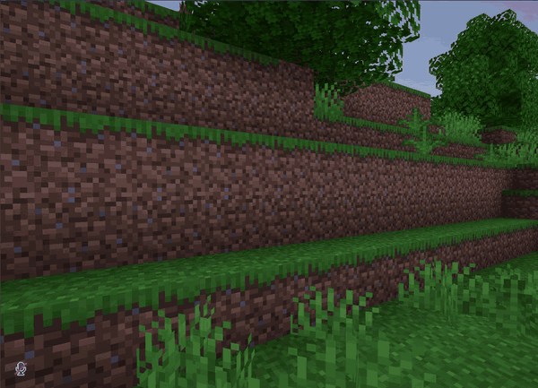
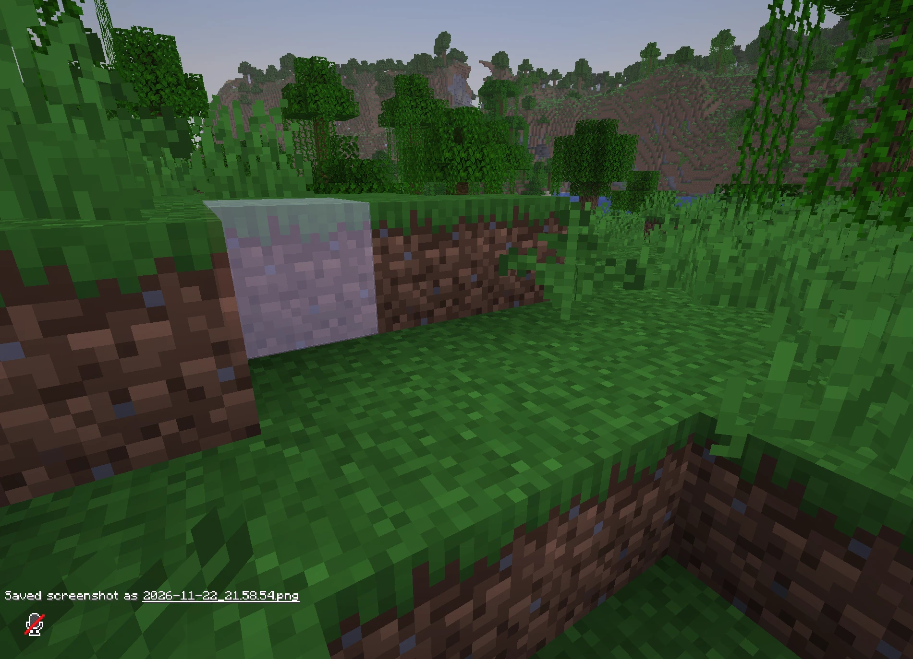
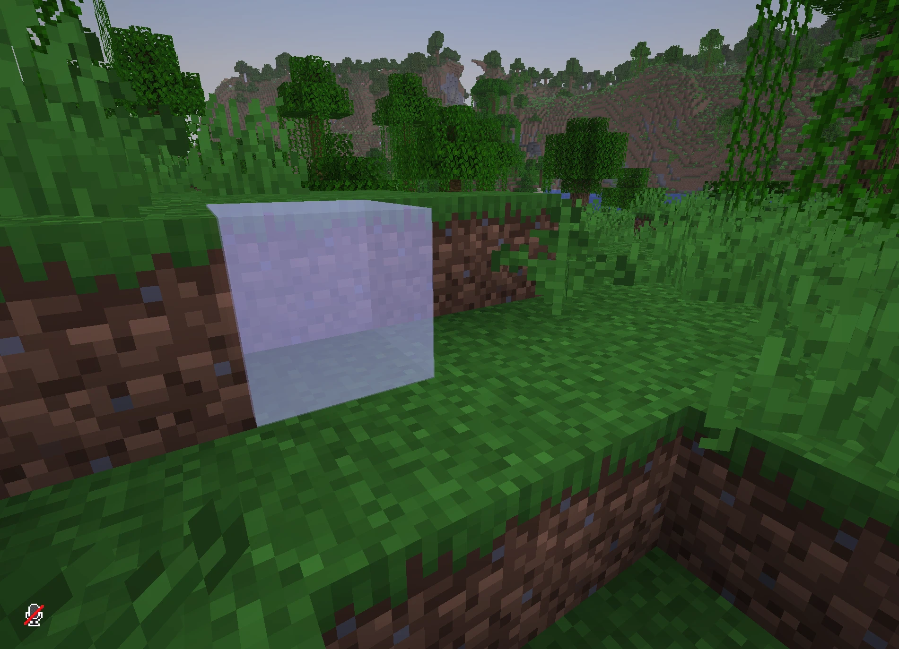
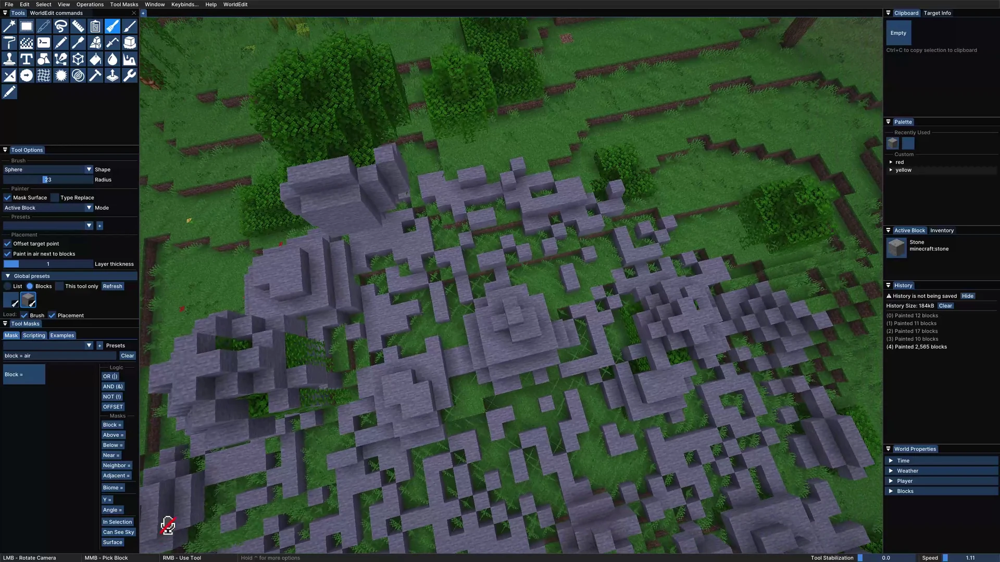
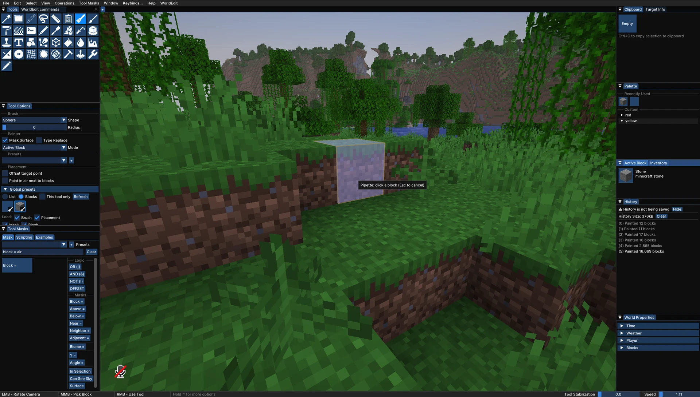

  

<h1 align="center">Axiom Utilities</h1>

  Quality-of-life addon for the <a href="https://modrinth.com/mod/axiom">Axiom</a> editor. 
  Unofficial. Not affiliated with or endorsed by Moulberry or the Axiom project.

  

  <a href="https://modrinth.com/mod/axiom-utilities">Modrinth</a> ·
  <a href="https://github.com/Vivegass/axiom-utilities/releases">Releases</a>

## Features

Everything lives inside Axiom's own **Tool Options** window and **Select Block** dialog — no new keybinds, no extra screens.

### Offset target point — for every tool
The Modelling and Shape tools have an *Offset target point* checkbox that aims at the block **next to** the face you look at instead of the block itself. Axiom Utilities adds that checkbox to every other tool (under **Placement**), remembered per tool.

| Off (Axiom default) | On |
|---|---|
|  |  |

### Paint in air next to blocks
Painter, Noise Painter and Gradient Painter normally only recolour existing blocks. Tick **Paint in air next to blocks** and they paint into the air layer that touches the surface instead, keeping all their settings — block percentages, noise, gradients, masks. **Layer thickness** (1–6) controls how far from the surface the layer reaches.

### Global presets
A **Global presets** section at the bottom of Tool Options saves the current state and brings it back in one click:

- **Brush settings** — everything in the tool's options (shape, size, blocks and percentages, noise, gradient, …)
- **Placement** — the options above
- **Tool mask** — the mask or mask script from the Tool Masks window (the window is reopened on load, since Axiom masks only apply while it is open)
- **Active block**

Tick what goes into a preset when saving, and what to apply when loading. Picking a preset loads it immediately and switches to its tool. Two views:

- **List** — a dropdown, like Axiom's own presets
- **Blocks** — a grid of tiles showing the preset's main block with the tool's icon in the corner; hover for the name, right click to overwrite or delete

Presets are plain files in `config/axiom-utilities/presets/`, so they are easy to back up or share.

### Block pipette
The **Select Block** dialog (opened from any block list — Painter, Gradient Painter, Noise Painter, …) gets a **Pick from world (pipette)** button. Click it, then click any block in the world to put it into that slot, including its block state. `Esc` cancels.

## Requirements

| | |
|---|---|
| Minecraft | 26.3 |
| Loader | Fabric Loader 0.16+ |
| Axiom | 6.1.x (built and tested against 6.1.5) |
| Java | 25 |
| Side | client only |

Axiom Utilities hooks into Axiom's internals, so it is pinned to Axiom 6.1.x. If a newer Axiom breaks it, the game still starts — the affected feature just stops showing up — until an update is released.

## Installation

1. Install Fabric Loader and Axiom for Minecraft 26.3.
2. Download `axiom-utilities-<version>.jar` from [Modrinth](https://modrinth.com/mod/axiom-utilities) or [Releases](https://github.com/Vivegass/axiom-utilities/releases) and drop it into your `mods` folder.

Settings are stored in `config/axiom-utilities/` (`placement.json` and `presets/`).

## Building

The mod is built with plain `javac` (Minecraft 26.3 ships unobfuscated, so no Loom/remapping is needed). It compiles against the libraries a [Prism Launcher](https://prismlauncher.org/) install already has after launching Minecraft 26.3 with Fabric once.

1. Put `Axiom-6.1.x-for-MC26.3.jar` into `libs/` (Axiom is not redistributable, so it is not in this repository).
2. Run `./build.sh` (Git Bash on Windows works). Set `JAVA_HOME`, `PRISM` or `AXIOM` if your paths differ.
3. The jar is written to `build/libs/`.

Mod version, author and links live in `mod.properties`; `fabric.mod.json` is generated from it. The icon is drawn by `tools/make_icon.py` (Pillow).

## License

[MIT](LICENSE). Axiom itself is a separate, proprietary mod by Moulberry and is not included.
